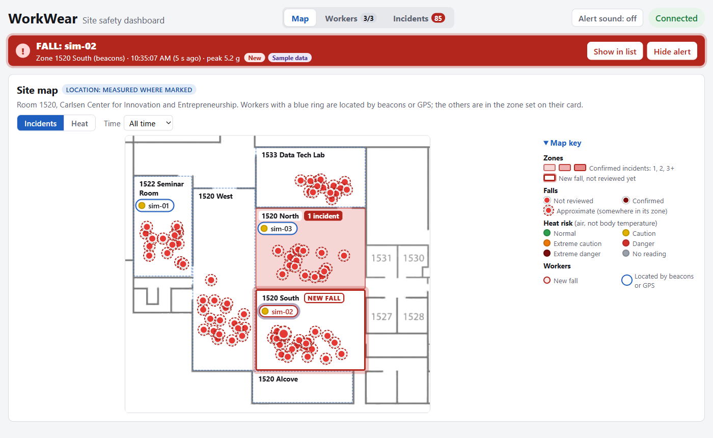
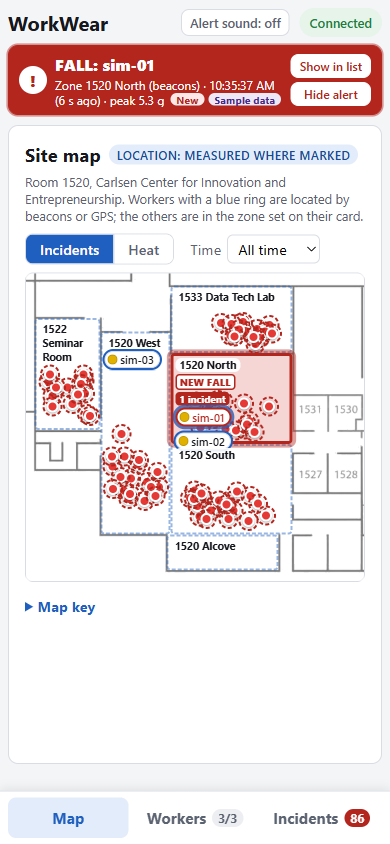

# WorkWear dashboard

The supervisor's view: who is wearing a helmet, their heat risk, which zone they are in, and every fall or reported incident. Plain HTML, CSS, and JavaScript, served by the server. There is no build step, and it needs no internet connection.



*Screenshots use the simulator, so every helmet is simulated and its incidents are labeled sample data.*

## 1. Open it

1. Start the server ([`server/README.md`](../server/README.md), sections 1 and 3).
2. Open <http://localhost:8000/> in a browser.

The header says **Connected** when the server answers. On a phone or tablet on the same network, open `http://<laptop IP>:8000/` (find the IP and fix network problems with [`server/README.md` section 5](../server/README.md#5-let-the-esp32-reach-the-server)).

To try it without helmets, run the simulator in a second terminal:

```bash
cd server
python3 simulator.py --devices 3 --fall-every 30 --heat-ramp 5
```

Three simulated helmets appear within a second. Every 30 s one of them "falls", and the alert line under the header turns red.

## 2. What is on the page

| Part | What it does |
|---|---|
| **Tabs** | One view at a time: **Map**, **Workers** (shows online / all helmets), and **Incidents** (shows how many are new, in red). The page opens on the map, which is sized to fit the window so nothing scrolls. The tabs are in the header; on a phone (700 px wide or less) they are a bar at the bottom. "Show in list" and clicking a fall dot switch to Incidents. |
| **Alert line** | The line under the header is always there and never changes size, so an alert never moves or covers anything. It reads "No fall alerts" until a fall arrives while the page is open; then it turns **red and pulses**, with who, where, when, and the peak g, and **Show in list** / **Hide alert**. It stays until you click **Hide alert**. Falls that were already in the list when the page opened do not raise it. The browser tab title also shows the count, e.g. "(1) FALL". Only the area below the alert line scrolls. |
| **Alert sound** | Off when the page opens: browsers block sound until you click something. Click **Alert sound: off** to turn it on (it plays a test beep). |
| **Workers** | One card per helmet: name, online/offline (offline = nothing for 5 s), heat risk color and reading, helmet on/off, last seen. **Click the name to rename** (Enter saves, Esc cancels). **Pick a zone** from the list to say where the worker is. Both are saved on the server, and new incidents use the name and zone at that moment. |
| **Site map** | The floor plan of room 1520 (from `zones.json`) with its zones drawn on it. A dot per worker in their zone, colored by heat risk. Workers without a zone are listed under "Not on the map". |
| **Fall dots** | Every fall that isn't dismissed is a red dot on the plan (Incidents layer; the **Time** filter applies). Bright = not reviewed, dark = confirmed; a new fall's dot pulses. With a GPS position (and `gps_points` set up, section 4) the dot is at that spot. Otherwise it sits at a fixed spot inside the zone the fall was recorded in, with a **dashed ring meaning "approximate"**. Hover for who, when, and how sure; click to jump to it in the list. Worker names and zone labels are always drawn on top of fall dots. |
| **Located workers** | Workers whose helmet located itself (BLE beacons or GPS) have a **blue ring**, and their card says "Located in ... by beacons". The map tag then reads "Location: measured where marked" instead of "Simulated location". Otherwise the zone picked on the card is used. |
| **New fall on the map** | The zone gets a thick **pulsing red outline** and a **NEW FALL** tag, and the worker's dot pulses. This is never a fill, so a live fall can't be mistaken for a past hazard. It lasts until the alert is hidden or the fall is confirmed or dismissed. |
| **Map key** | The colors and what they mean, in short groups (Zones, Falls, Heat risk, Workers). Beside the map on wide screens; on smaller ones, tap **Map key** under the map and it opens over the bottom of the map, so there is nothing to scroll. |
| **Map layers** | **Incidents** fills each zone **red** by its number of **confirmed** incidents (light, medium, dark = 1, 2, 3 or more) with a count tag. Confirming a fall turns its zone's outline into a red fill. **Heat** tints each zone in the heat-risk color of the highest heat index measured there. **Time** limits both to the last 24 h, 8 h, or hour. Hover a zone for the full text. |
| **Incidents** | Newest first, with badges: New / Confirmed / Dismissed, Sample data, Arrived late. **Confirm** a real incident, **Dismiss** a false alarm, or **Mark new** to undo. Add or edit a note on any incident. Confirming or dismissing a fall also clears its alert. |
| **Report injury or hazard** | For things the helmet cannot detect, such as a cut hand or a wet floor. Pick the type and zone, and optionally the helmet (its name is copied) or a typed name. Reports start as New; confirm them for them to count on the map. |



## 3. What the labels mean

These labels keep the demo honest (see "Honesty rules" in [`CLAUDE.md`](../CLAUDE.md)). Don't remove them.

| Label | Meaning |
|---|---|
| **Simulated helmet** | The device ID starts with `sim-`: it is the simulator, not hardware. |
| **Sample data** | An incident from a simulated helmet. Zone tags on the map say "sample" (or "incl. sample") when their count contains any. |
| **Simulated location** | Zones are set by hand on the worker cards; nothing measures where the worker is. |
| **Heat risk** | Based on air temperature and humidity at the helmet (the heat index), **not** body temperature. Colors follow the bands in [`docs/PROTOCOL.md`](../docs/PROTOCOL.md) section 7. |
| **Arrived late** | The helmet held the fall while its Wi-Fi was down and sent it more than 5 s later. The time shown is when the server got it. |

## 4. Change the site map

Edit [`zones.json`](zones.json). It points at a floor-plan image and draws each zone as a rectangle on it:

```json
{
  "site": "Room 1520, Carlsen Center for Innovation and Entrepreneurship",
  "image": "floorplan.png",
  "width": 555,
  "height": 505,
  "zones": [
    { "id": "1520-W", "label": "1520 West", "x": 122, "y": 95, "w": 115, "h": 334 },
    { "id": "1522", "label": "1522 Seminar Room", "x": 14, "y": 73, "w": 108, "h": 184 }
  ]
}
```

- `image` is a file in `dashboard/`. `width` and `height` are its size in pixels.
- `x`, `y` are a zone's top-left corner and `w`, `h` its size, **in the image's pixels** (measure them in any image editor). The zones follow the image when the page resizes.
- `id` is what is stored on the server (up to 32 characters, no spaces). `label` is what the map, the zone pickers, and the incident list show.
- The zones today: room 1520 is split into **West, North, South, and Alcove**, plus the **1522 Seminar Room** and **1533 Data Tech Lab**. The small offices (1527 to 1531) are on the plan but are not zones; add one with a new line.
- `floorplan.png` is the building plan with the room names inside the zones and the outdoor labels removed, so they don't clash with the zone labels.
- No floor plan? Leave out `image`, `width`, and `height` and use a grid instead: `"cols": 3, "rows": 2`, and give each zone a `"col"` and `"row"` (from 0, top left).
- Mistakes (duplicate IDs, a zone outside the image or grid, a missing image) are skipped and listed above the map. Reload the page after editing.
- If you rename or remove an `id`, workers already set to the old one show under "Not on the map" until you pick a new zone. Their past incidents keep the old zone.

### Put GPS positions on the plan (outdoors)

Off until you add `gps_points`: three or more spots you can find both on the plan and on a map. Building corners work well.

1. Open the dashboard as `http://localhost:8000/?calibrate` and click each spot on the floor plan. The page shows its `x` and `y` in image pixels.
2. For each spot, get its latitude and longitude, for example by right-clicking it in Google Maps.
3. Add them to `zones.json` (spots far apart, not in a line):

   ```json
   "gps_points": [
     { "x": 14,  "y": 20,  "lat": 41.00000, "lon": -96.00000 },
     { "x": 552, "y": 20,  "lat": 41.00000, "lon": -96.00000 },
     { "x": 14,  "y": 489, "lat": 41.00000, "lon": -96.00000 }
   ]
   ```

   (The numbers above are placeholders: use your own.)
4. Reload the page. The server reads the file on its own; `http://localhost:8000/api/site` should say `"gps_ready": true`, and `max_error_px` should be small (a few pixels). A big error means a point was measured wrong.

Falls with a GPS fix then appear at their position, and a GPS fix inside a zone sets the worker's zone. **Indoors the GPS gets no fix**, so inside room 1520 this changes nothing; use beacons for that (`firmware/README.md`).

## 5. Run the tests

You need **Node 18 or newer** (tested on 24). No packages to install.

```bash
cd dashboard
node --test
```

The tests cover the parts that make decisions (heat labels, which falls raise the alert, map placement, report and note checks) in `logic.js`. The page itself was checked by hand and with scripted browser checks; [`PLAN.md`](../PLAN.md) records the results for each phase (D1 to D6).

## Troubleshooting

| Problem | Fix |
|---|---|
| **"Can't reach server"** in red | The server stopped or the network dropped. The page keeps the last data and reconnects by itself. Start the server again (`server/README.md` section 3). |
| The page is blank or unstyled | Open it through the server (`http://localhost:8000/`), not by double-clicking `index.html`. |
| No sound on a fall | Click **Alert sound: off** to turn it on. You need to do this each time the page is opened. |
| A rename or zone change shows a red message | The server refused or did not answer; the message says why. The old value is kept. |
| The map says zones.json could not be loaded | The file has a JSON error (a missing comma is common). Check it with `python3 -m json.tool dashboard/zones.json`. |
| A worker is not on the map | They have no zone, or a zone not in `zones.json`. Pick one on their card. |
| An old fall doesn't raise the alert | That is on purpose: only falls that arrive while the page is open do. Check the list for anything still marked New (the red count on the Incidents tab). |

## Layout

```
dashboard/
  index.html          page structure
  style.css           look and layout (tabs; tab bar at the bottom under 700 px)
  app.js              loads data every second and draws the page
  logic.js            decisions without the page (tested)
  api.js              talks to the server (2 s timeout)
  zones.json          the site map: floor plan and zones
  floorplan.png       floor plan of room 1520 used by zones.json
  tests/logic.test.js node --test tests
```
